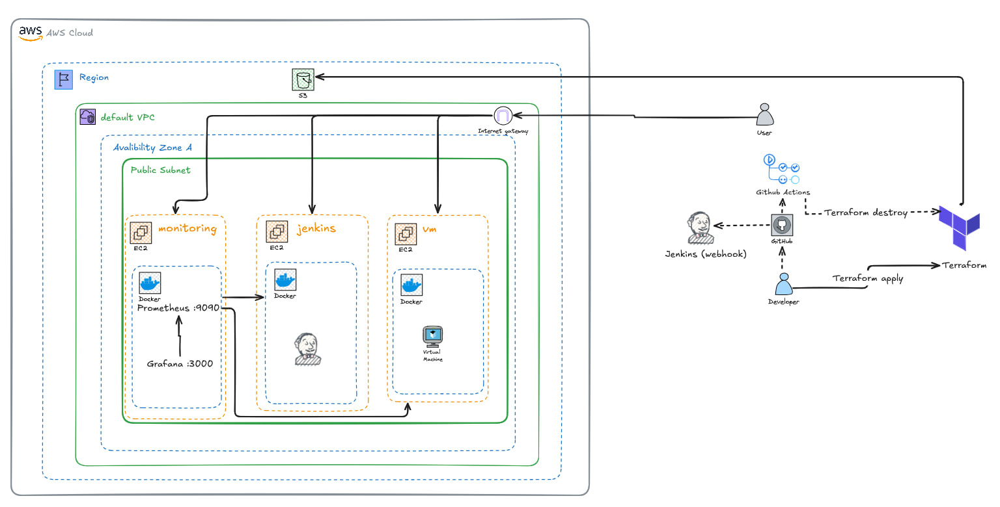

<h1 align="center">PHP Application by Team 1</h1>

Jenkins · GitHub Actions · Docker · Terraform · Prometheus + Grafana

---

## 🏗 Архітектура системи

Проєкт базується на хмарній інфраструктурі AWS, розгорнутій за допомогою Terraform.

🔗 **[Відкрити схему в Excalidraw](https://excalidraw.com/#json=HAjqcw4F5L_uam_gv4R0k,T5MGKXRX85mOfy9H6Puotg)**

- 📝 [WordPress](wordpress/README.md) — сервер `wp-app`, `deploy.sh`, RDS
- 🐳 Docker — Dockerfile, docker compose
- 🔧 [Jenkins](docs/jenkins.md) — Build → Test → Deploy → Smoke test, rollback
- 🐙  GitHub Actions — CI на PR, workflow `destroy-infra.yml`
- ☁️ [Terraform](docs/terraform.md) — EC2, Security Group, S3 state, apply/destroy
- 📊  Моніторинг — Prometheus + Grafana, node-exporter

---

Made with ❤️ by Team 1.
