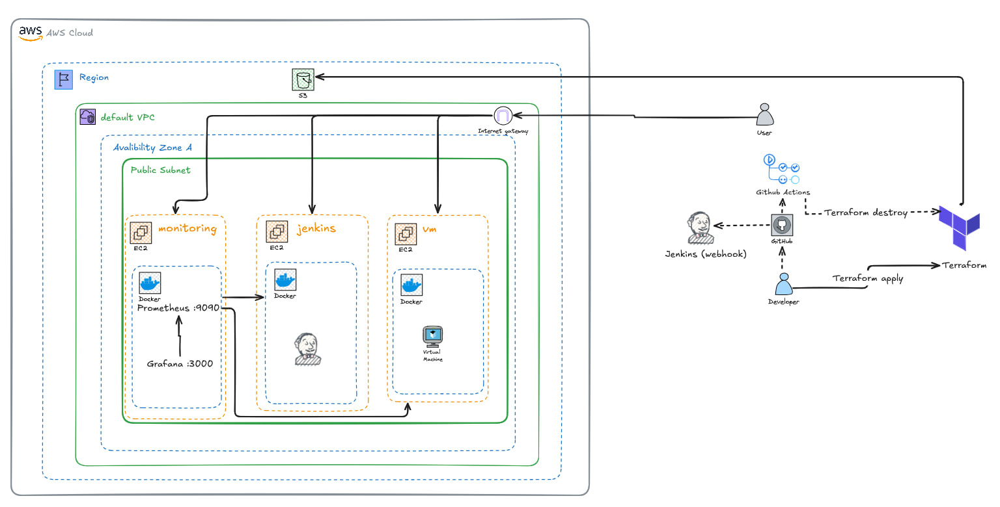

# ☁️ Terraform: інфраструктура проєкту



## Архітектура

Уся інфраструктура описана кодом у папці `terraform/` і створюється однією командою `terraform apply`.

- **AWS Region → default VPC → одна Availability Zone → Public Subnet.** Ми використовуємо стандартну VPC акаунта, щоб не створювати зайву мережеву інфраструктуру.
- **Internet Gateway** на межі VPC пропускає трафік з інтернету до серверів.
- **Три EC2-інстанси** (Ubuntu), на кожному встановлено Docker:
  - **`jenkins`**: Jenkins `:8080` і застосунок `myapp` `:8081`, який Jenkins збирає і деплоїть;
  - **`vm`**: сервер застосунку;
  - **`monitoring`**: Prometheus `:9090` і Grafana `:3000` у контейнерах.
- **node-exporter `:9100`** працює на `jenkins` і `vm`. Prometheus збирає з нього метрики сервера (CPU, пам'ять, диск, мережа), а Grafana їх показує.
- **Security Group** обмежує доступ: SSH, Jenkins і Grafana відкриті лише з IP розробника (`ip_cidr`), а порт 9100 відкритий тільки між нашими серверами.
- **S3 bucket** зберігає state Terraform (`terraform.tfstate`). Завдяки цьому інфраструктуру бачать і локальний Terraform, і GitHub Actions (workflow для видалення).
- **SSH key pair** створюється Terraform з публічного ключа розробника.

### Файли

```
terraform/
├── main.tf                   # провайдер, backend, ресурси
├── variables.tf              # змінні: public_key, ip_cidr
├── outputs.tf                # IP-адреси після apply
├── backend.hcl               # bucket, key, region для state
├── terraform.tfvars          # власні значення (не в git)
└── terraform.tfvars.example  # шаблон
```

## Як запустити

**1. Профіль AWS**:

```powershell
aws configure --profile team1
$env:AWS_PROFILE = "team1"
aws sts get-caller-identity
```

**2. Bucket для state**:

```powershell
aws s3 mb s3://softserve-team1-tfstate-chester
aws s3api put-bucket-versioning --bucket softserve-team1-tfstate-chester --versioning-configuration Status=Enabled
```

**3. SSH-ключ і змінні:**

```powershell
ssh-keygen -t ed25519 -C "softserve_team1" -f $env:USERPROFILE\.ssh\id_ed25519_team1
Get-Content $env:USERPROFILE\.ssh\id_ed25519_team1.pub
```

`terraform/terraform.tfvars`:

```hcl
ip_cidr    = "x.x.x.x/32"        # curl -s ifconfig.me OR (Invoke-WebRequest -UseBasicParsing https://ifconfig.me/ip).Content
public_key = "ssh-ed25519 AAAA... softserve_team1"
```

**4. Створення інфраструктури:**

```powershell
cd terraform
terraform init "-backend-config=backend.hcl"
terraform validate
terraform plan
terraform apply        # підтвердити: yes
```

**5. Запуск Jenkins** на сервері `jenkins`:

```bash
ssh -i ~/.ssh/id_ed25519_team1 ubuntu@<IP jenkins>
git clone https://github.com/<акаунт>/jenkins-cicd.git
cd jenkins-cicd/jenkins
sudo docker compose up -d --build
sudo docker exec jenkins cat /var/jenkins_home/secrets/initialAdminPassword
```
## Видалення

GitHub: **Actions → Terraform Destroy → Run workflow** → ввести `destroy`
